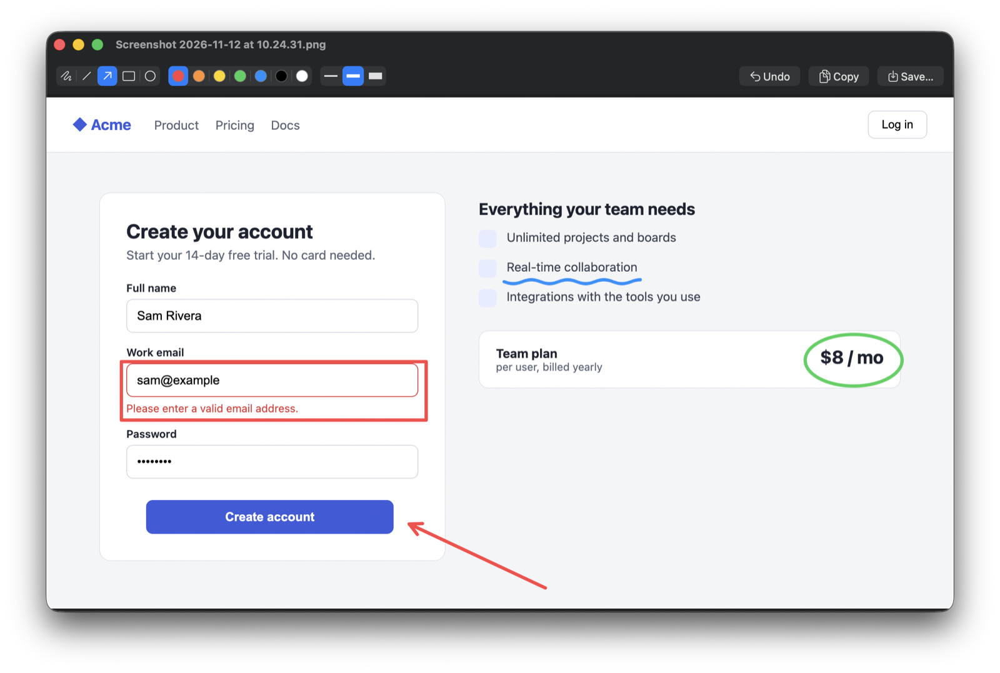
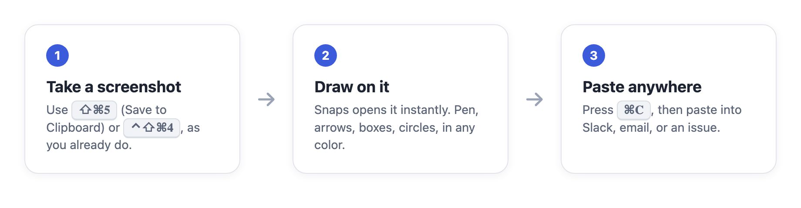

# Snaps

Draw on your Mac screenshots, then paste them anywhere.



Snaps doesn't replace the macOS screenshot tool. You keep taking screenshots the way you already do. When one lands on your clipboard, Snaps opens it in a small editor. You draw on it, press ⌘C, and paste it into Slack, an email, or an issue. Nothing is saved to disk unless you ask.



- Free draw, line, arrow, rectangle, ellipse
- 7 colors, 3 line widths, undo
- Copy (⌘C) at full Retina resolution, or Save… (⌘S) as PNG
- Lives in the menu bar and starts at login

## Install

```sh
curl -fsSL https://raw.githubusercontent.com/amims71/snaps/main/install.sh | sh
```

Requirements: macOS 14 or later. Snaps is built from source on your Mac, so it needs Apple's Command Line Tools. The installer offers to install them if they're missing.

Run the same command again to update.

## Setup (once)

Press **⇧⌘5**, open **Options**, and choose **Save to: Clipboard**. From then on, every screenshot you take with ⇧⌘3, ⇧⌘4 or ⇧⌘5 opens in Snaps.

If you'd rather keep saving screenshots to files, use **⌃⇧⌘4** (or ⌃⇧⌘3) whenever you want to draw on one. Those shortcuts always copy to the clipboard.

macOS may ask once whether Snaps can paste from other apps. Allow it: that's how Snaps sees the screenshot. Snaps only reads the clipboard when it holds an image, and it opens only real screenshots. Images you copy from other apps are ignored.

## Use

| Key | Action |
|-----|--------|
| ⌘C | Copy the edited image |
| ⌘S | Save as PNG |
| ⌘Z | Undo |
| ⌘W | Close |

The menu bar icon has **Open Image…** to draw on any image file, and **Launch at Login** to turn auto-start on or off.

## Uninstall

```sh
curl -fsSL https://raw.githubusercontent.com/amims71/snaps/main/install.sh | sh -s uninstall
```

## Build it yourself

```sh
git clone https://github.com/amims71/snaps && cd snaps
./build.sh && open build/Snaps.app
```

## License

MIT
